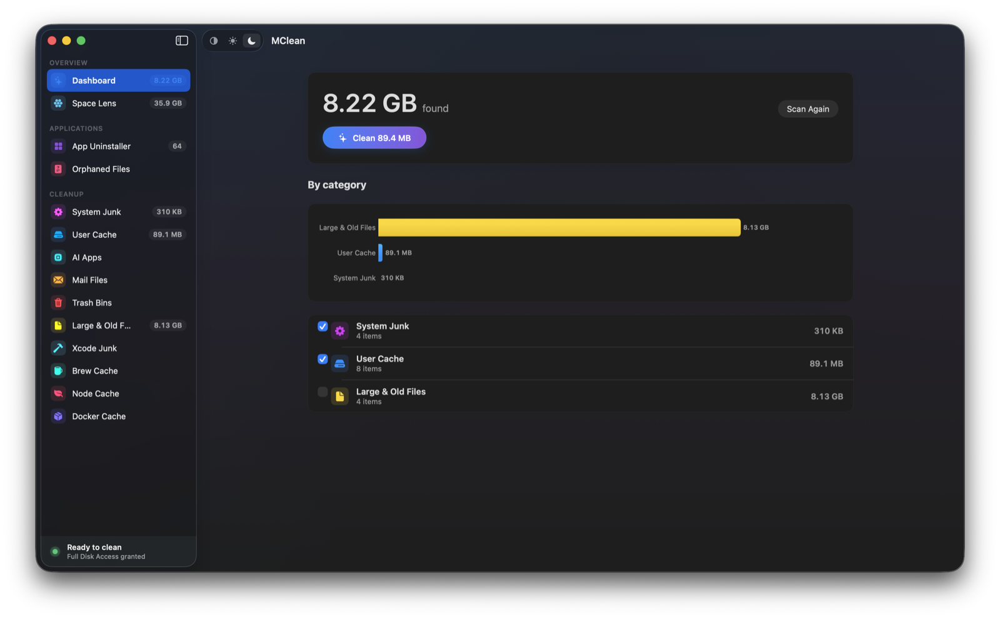
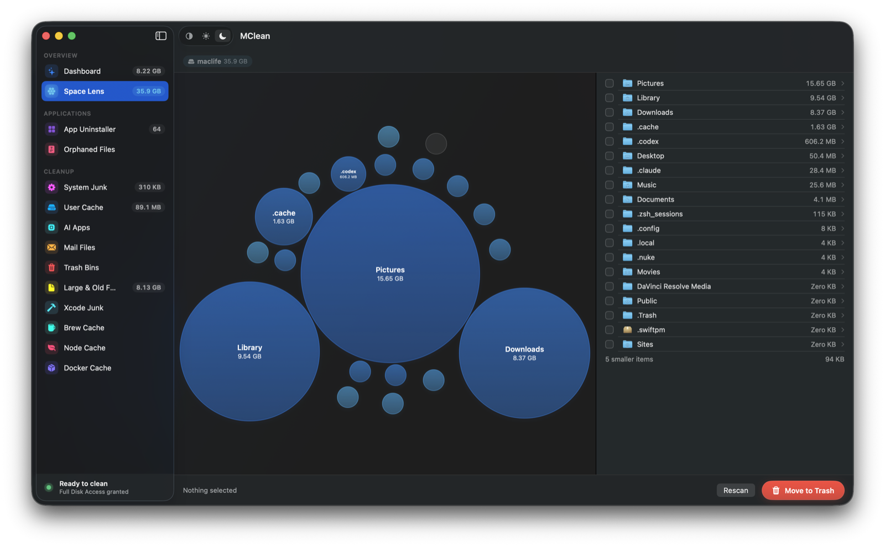
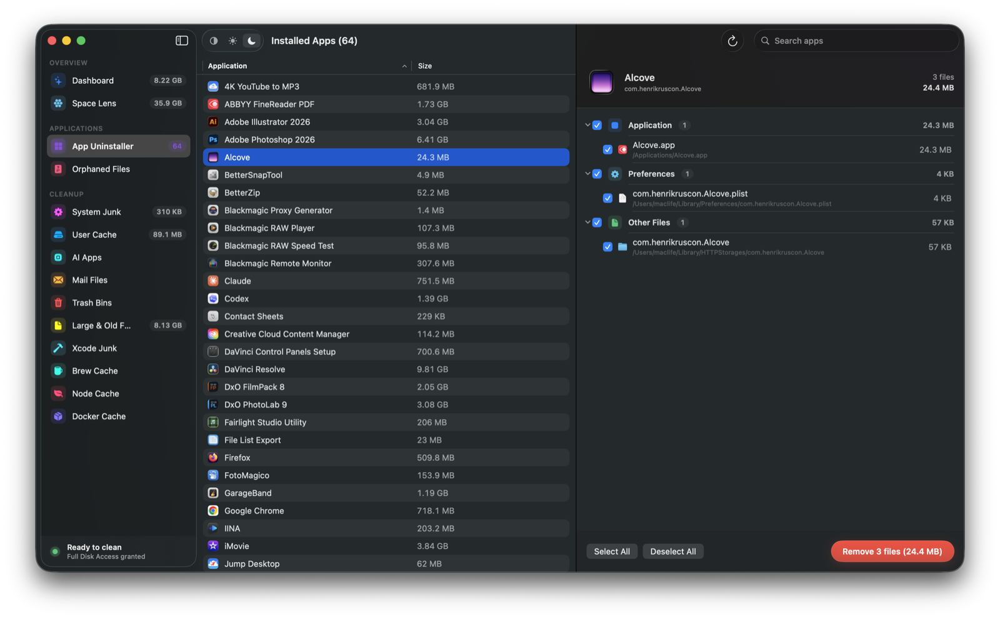

<p align="center">
  
</p>

<p align="center">
  <b>Tiếng Việt</b> |
  <a href="docs/README.en.md">English</a> |
  <a href="docs/README.ja.md">日本語</a> |
  <a href="docs/README.zh-Hans.md">简体中文</a> |
  <a href="docs/README.zh-Hant.md">繁體中文</a>
</p>

<h1 align="center"><br>MClean</h1>

<p align="center">
  <b>Giành lại dung lượng máy Mac của bạn.</b><br>
  Dọn rác, gỡ ứng dụng tận gốc và soi ổ đĩa bằng bản đồ bong bóng — miễn phí, mã nguồn mở.<br>
  Không thuê bao. Không thu thập dữ liệu. Không hù dọa.
</p>

<p align="center">
  
  
  
  
  <a href="LICENSE"></a>
</p>

<p align="center">
  <a href="#tính-năng">Tính năng</a> ·
  <a href="#cài-đặt">Cài đặt</a> ·
  <a href="#cam-kết">Cam kết</a> ·
  <a href="#quyền-truy-cập">Quyền truy cập</a> ·
  <a href="#đóng-góp">Đóng góp</a>
</p>

---

## Tính năng

### 🧹 Quét thông minh

Một nút bấm quét **10 hạng mục song song có giới hạn**: rác hệ thống, cache người dùng, ứng dụng AI (Ollama, LM Studio), tệp Mail, thùng rác, tệp lớn & cũ, rác Xcode, cache Brew / Node / Docker. Giới hạn số tác vụ đồng thời giúp ổ đĩa không bị quá tải. Kết quả hiển thị theo biểu đồ từng hạng mục để bạn duyệt trước khi dọn.

- Cache được phát hiện **động** theo ứng dụng thật trên máy, không dùng danh sách cứng
- Tệp lớn & cũ (>100 MB hoặc >1 năm) **không bao giờ được chọn sẵn**
- Dung lượng purgeable của APFS chỉ hiển thị để minh bạch — MClean **không** nhận vơ "thu hồi" thứ mà chỉ macOS kiểm soát được

### 🔍 Space Lens — soi ổ đĩa bằng bản đồ bong bóng

<p align="center">
  
</p>

Quét thư mục Nhà (hoặc bất kỳ thư mục nào) và xem toàn bộ dung lượng dưới dạng **bong bóng tỉ lệ theo byte thật**. Nhấp bong bóng để đi sâu vào từng thư mục, breadcrumb để quay ra, tick chọn ở danh sách bên phải rồi chuyển tất cả vào Thùng rác.

- Kích thước là **byte cấp phát thật**: hard link loại trùng, symlink không đi theo, tệp ẩn được tính
- Gói `.app` được coi là một mục như Finder
- Thư mục thiếu quyền đọc được **đánh dấu rõ** thay vì âm thầm tính thiếu

### 🗑 Gỡ ứng dụng tận gốc

<p align="center">
  
</p>

Chọn một ứng dụng và MClean đối chiếu bundle ID, tên ứng dụng, container và cấu trúc đường dẫn để tìm preferences, caches, launch agents, logs cùng các tệp hỗ trợ liên quan. Các kết quả nằm trong vùng người dùng hoặc công cụ dùng chung được để bỏ chọn mặc định nhằm tránh xoá nhầm dữ liệu không thuộc ứng dụng.

- Ba mức độ nhạy: **Nghiêm ngặt · Nâng cao · Sâu**
- Ứng dụng hệ thống của Apple được bảo vệ, không thể gỡ nhầm
- Chuột phải app trong Finder → **Dịch vụ → Uninstall with MClean** để gỡ nhanh

### 🧩 Tìm tệp mồ côi

Duyệt `~/Library` tìm tệp của những ứng dụng **đã bị xoá từ lâu** — cache, container, preferences còn sót từ app bạn gỡ năm ngoái vẫn đang chiếm chỗ. So khớp với danh sách ứng dụng đang cài để không báo nhầm.

### ⏰ Dọn dẹp theo lịch

Tuỳ chọn quét theo chu kỳ (mỗi giờ → mỗi tháng), có ngưỡng dung lượng tối thiểu và thông báo kết quả. Lịch chạy hoạt động khi MClean đang mở hoặc trình theo dõi trên thanh menu đang bật; tự động dọn chỉ được thực hiện khi bạn chủ động bật và không bao giờ tự động dọn Thùng rác.

### Và những thứ nhỏ mà chất

- **Theo dõi hệ thống trên thanh menu**: CPU / RAM / đĩa trực tiếp, bật tắt trong Cài đặt
- **5 ngôn ngữ**: Tiếng Việt, English, 日本語, 简体中文, 繁體中文
- **Giao diện sáng / tối / theo hệ thống**, thiết kế native SwiftUI
- **Nhẹ**: cả app ~11 MB, không nhúng framework ngoài

## Cài đặt

Build từ mã nguồn — cần **Xcode 16+** và **macOS 13 trở lên**:

```bash
brew install xcodegen
git clone https://github.com/maclifevn/MClean.git
cd MClean
xcodegen generate
xcodebuild -project MClean.xcodeproj -scheme MClean -configuration Release \
  -derivedDataPath build build
open build/Build/Products/Release/MClean.app
```

> Bản cài sẵn (`.dmg`) và `.zip` có tại mục **Releases** của kho mã nguồn.

## Cam kết

Một app dọn Mac xin quyền sâu nhất macOS có (Toàn quyền Truy cập Đĩa) rồi xoá tệp của bạn — điều đó đòi hỏi niềm tin. Đây là hợp đồng MClean tự ràng buộc, kiểm chứng được từng dòng trong mã nguồn:

| Cam kết | Cụ thể |
|---|---|
| **Ưu tiên Thùng rác** | Tệp dọn dẹp và tệp ứng dụng được chuyển vào Thùng rác qua `FileManager.trashItem`; **Dọn Thùng rác**, xóa runtime, Docker prune và xóa snapshot Time Machine là các thao tác vĩnh viễn, có xác nhận riêng |
| **Không thu thập dữ liệu** | Không analytics, không crash report, không gọi mạng về chúng tôi |
| **Không hù dọa** | Không "máy bạn đang gặp nguy!", không bộ đếm đỏ giả tạo — chỉ số liệu trung tính |
| **Bạn kiểm soát tự động hoá** | Mặc định luôn xác nhận và hiển thị đường dẫn thật; quét/dọn theo lịch chỉ chạy khi bạn chủ động bật trong Cài đặt |
| **Kiểm tra được** | MIT — mã quyết định xoá gì nằm ở [`MClean/Services`](MClean/Services) và [`MClean/Logic/Scanning`](MClean/Logic/Scanning) |

Nếu một ngày MClean thêm telemetry, khoá tính năng sau tường phí hay quét kiểu hù dọa — nó đã trở thành thứ nó sinh ra để thay thế. Hãy bắt chúng tôi giữ lời.

## Quyền truy cập

MClean cần **Toàn quyền Truy cập Đĩa** để đọc những nơi macOS ẩn khỏi mọi ứng dụng (tệp Mail, dữ liệu Safari, container được bảo vệ). Thiếu quyền này một số vị trí sẽ không được quét hoặc dọn; mức ảnh hưởng tùy dữ liệu trên máy. Màn hình đầu tiên hướng dẫn cấp quyền từng bước; nếu thao tác nào thất bại vì quyền, MClean tự mở Cài đặt và **thử lại đúng phần bị lỗi** khi quyền có hiệu lực. Sau khi bật quyền, có thể cần mở lại ứng dụng.

Quét và phân tích tệp chạy cục bộ, không cần mạng. Sparkle dùng GitHub để kiểm tra/tải cập nhật MClean; công cụ cập nhật ứng dụng khác dùng Homebrew. Không thu thập telemetry. Các thao tác dọn đặc biệt được mô tả rõ trước khi xác nhận.

## Bảo mật

- Chống tấn công symlink: phân giải đường dẫn trước khi kiểm tra, phân giải lại ngay trước khi xoá (giảm khoảng thời gian có thể bị thay đường dẫn)
- Danh sách cho phép: đường dẫn ngoài vùng an toàn bị từ chối xoá
- Ứng dụng hệ thống Apple không thể gỡ trong mọi trường hợp
- Mọi thao tác xoá yêu cầu xác nhận rõ ràng theo mặc định

Phát hiện lỗ hổng? Vui lòng mở **security advisory riêng tư** thay vì issue công khai.

## Đóng góp

Hoan nghênh pull request — xem [CONTRIBUTING.md](CONTRIBUTING.md). Đặc biệt mong:

## Giấy phép

MIT — xem [LICENSE](LICENSE). Dùng, fork, phát hành dưới tên bạn nếu muốn; điều duy nhất giấy phép yêu cầu là giữ lại thông báo bản quyền.

## Đồng bộ PureMac, giữ giao diện MClean

Ngày 11/10/2026, MClean đã nhận cập nhật chức năng PureMac 3.1.0 đến commit `0eca648`, giữ Dashboard, bộ màu, bố cục cửa sổ và Settings dạng tab hiện có.

- Thêm tìm tệp trùng, ảnh tương tự, kiểm tra bảo mật, hiệu năng theo ứng dụng và cập nhật ứng dụng Homebrew vào sidebar cũ.
- Tích hợp cải tiến Space Explorer vào Space Lens: cùng cây quét cho bản đồ và danh sách, sắp xếp, xem tệp nhỏ, giữ vị trí khi quét lại và báo kết quả chưa đầy đủ.
- Bổ sung cache XcodeBuildMCP/MobileBuildMCP, pnpm, OrbStack, Puppeteer, Playwright, Electron, node-gyp và Hugging Face. Runtime, Docker prune và bộ tải Hugging Face không được chọn sẵn.
- Có bộ lọc dung lượng/ngày, chọn các dòng đang hiện và danh sách loại trừ. Lịch dọn chờ các thao tác và hộp xác nhận hoàn tất.
- Settings có tab Cập nhật dùng **Sparkle** để kiểm tra, tải và cài bản MClean đã xác thực chữ ký; hỗ trợ kiểm tra hằng ngày và cài tự động khi người dùng bật. Có 14 ngôn ngữ, gồm tiếng Việt và các bản dịch upstream.

Tệp thường được đưa vào Thùng rác. Dọn mục đã trong Thùng rác, xóa runtime, Docker prune và xóa snapshot Time Machine là thao tác không thể hoàn tác qua Thùng rác. Sparkle cập nhật MClean qua GitHub; công cụ cập nhật các ứng dụng khác dùng Homebrew. Các thao tác cập nhật có kết nối mạng. Không có telemetry.

Chi tiết phạm vi ghép và kiểm chứng: [UPSTREAM-SYNC.md](docs/UPSTREAM-SYNC.md). **[MClean 1.0.6 / build 7](https://github.com/maclifevn/MClean/releases/tag/v1.0.6)** đã phát hành với bản sửa nền toolbar Dashboard, bộ nhận diện Clean M, bản Universal ký Developer ID và được Apple notarize/staple. Sparkle cập nhật từ 1.0.5; checksum Homebrew khớp ZIP của release này.

Thiết lập khóa ký, phát hành appcast và kiểm thử macOS 15: [SPARKLE-UPDATES.md](docs/SPARKLE-UPDATES.md). Người dùng bản chưa có Sparkle cần cài bản có Sparkle đầu tiên một lần để nhận cập nhật trong app về sau.
